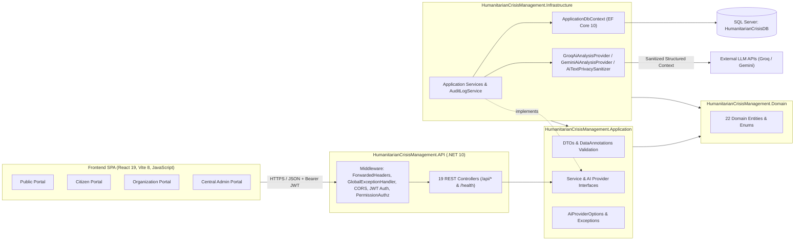
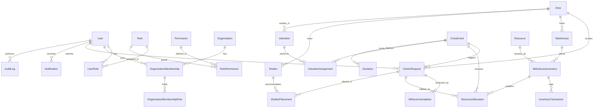
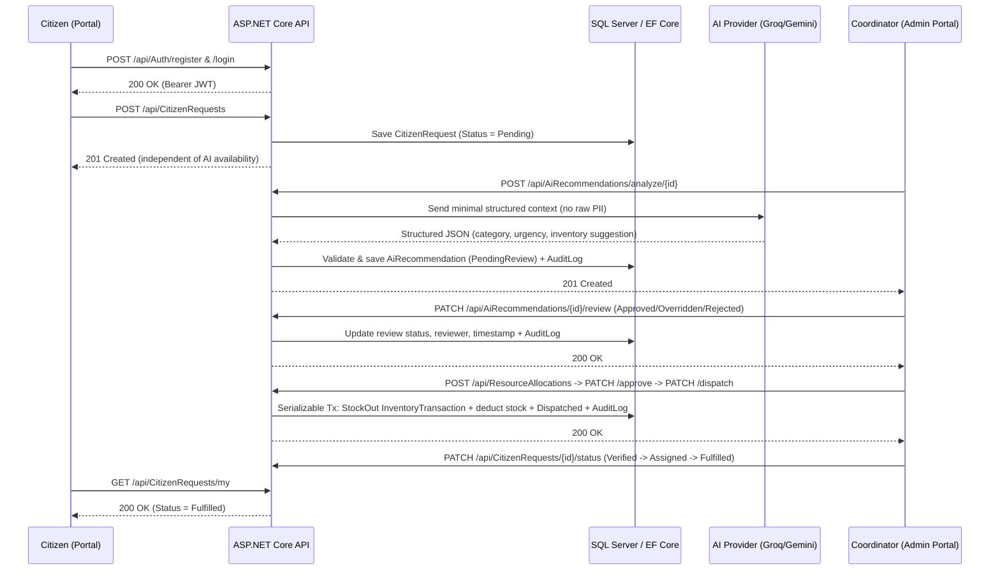
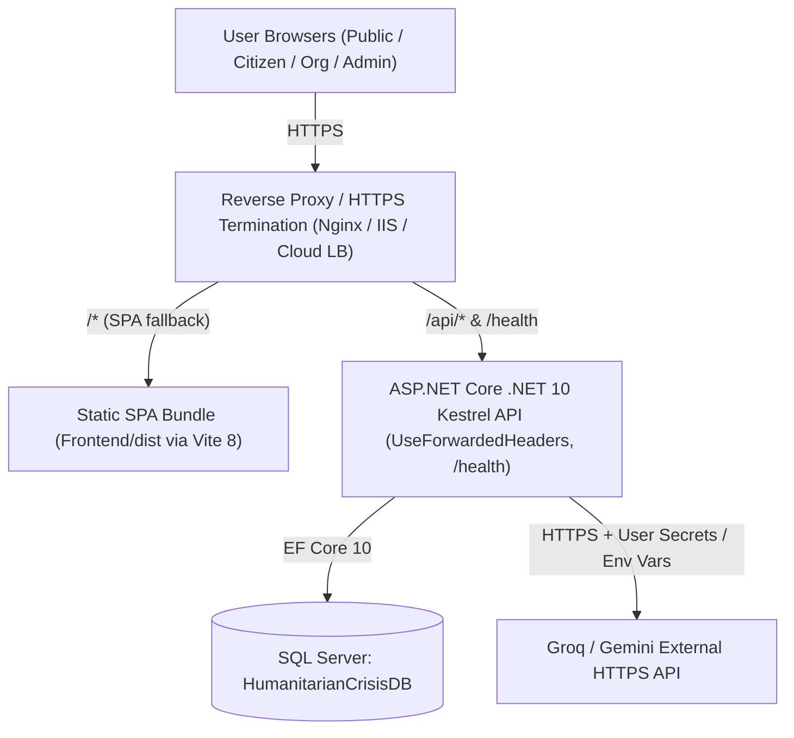

# AI-Powered Humanitarian Crisis Management and Aid Coordination Platform (HCMS / ReliefLink)

**Final Project Report**  
**Repository:** `https://github.com/HKChamod/HumanitarianCrisis.git`  
**Branch:** `upgrade/dotnet-10`  
**Target Submission Date:** 30 November 2026  

---

## 1. Introduction & Problem Statement

During rapid-onset humanitarian crises (floods, landslides, storms, and displacement emergencies), relief agencies and regional disaster coordinators face severe operational bottlenecks: fragmented citizen assistance requests, delayed triage, lack of real-time visibility into warehouse stock and shelter occupancy, duplicate relief requests, and uncoordinated volunteer deployments.

**HCMS (ReliefLink)** is a full-stack humanitarian crisis management and aid coordination platform designed to unify public emergency reporting, citizen request tracking, organization coordination, central administration, warehouse logistics, shelter capacity management, volunteer deployment, donation tracking, and **human-in-the-loop AI decision support**.

---

## 2. Objectives & Scope

### Core Objectives
1. Provide a unified, role-secured platform supporting four distinct web portals: **Public**, **Citizen**, **Organization**, and **Central Administration**.
2. Maintain strict **Clean Architecture** separation on an ASP.NET Core **.NET 10** backend with **EF Core 10** and **SQL Server** (`HumanitarianCrisisDB`).
3. Deliver **advisory-only AI decision support** (configurable **Groq** and **Google Gemini** providers) with strict privacy minimization (`IncludeSanitizedDescriptions=false`), deterministic server-side validation, and mandatory human review before operational execution.
4. Enforce atomic database transactions for multi-record operational workflows (resource allocation dispatch/cancellation, inventory stock updates, shelter check-in/check-out, and volunteer assignment lifecycle).
5. Preserve a complete, queryable **Audit Log** trail across critical administrative, operational, and AI review actions.

### Scope Boundaries
- **Implemented:** Full backend REST API (19 controllers, 22 EF Core entities, 14 migrations), JWT authentication + permission-based RBAC, AI Decision Support with Groq & Gemini providers, four live-wired React 19 (JavaScript) portals, deployment configuration (`DEPLOYMENT.md`, `appsettings.Production.json`, `/health`), and 179 automated backend tests.
- **Out of Scope / Future Work:** Live payment gateway integration for monetary donations, automated SMS/push gateway delivery, predictive time-series demand forecasting, multi-region database replication, and formal external user-acceptance testing (UAT) studies.

---

## 3. Functional & Non-Functional Requirements

### Functional Requirements (Implemented)
- **FR-01 Identity & RBAC:** User registration, JWT Bearer login, `/api/Auth/me`, role management, and 35+ granular permission policies enforced by `PermissionAuthorizationHandler`.
- **FR-02 Crisis & Area Management:** CRUD for geographic `Areas` and `CrisisEvents` (Active, Closed, Resolved).
- **FR-03 Citizen Assistance Requests:** Citizens submit and track requests (`Pending → Verified → Assigned → Fulfilled` / `Rejected`) independently of AI availability.
- **FR-04 AI Advisory Triage & Human Review:** Authorized coordinators trigger AI analysis (`POST /api/AiRecommendations/analyze/{citizenRequestId}`), inspect structured suggestions, and submit `Approved`, `Overridden`, or `Rejected` review decisions (`PATCH /api/AiRecommendations/{id}/review`). AI never mutates `CitizenRequest`, `ResourceAllocation`, or `WarehouseInventory`.
- **FR-05 Warehouse, Inventory & Resource Allocation:** Warehouse & resource catalog, `StockIn`/`StockOut`/`Adjustment`/`Transfer` transactions with non-negative stock enforcement, and full allocation lifecycle (`Pending → Approved → Dispatched → Delivered` / `Cancelled` with automatic stock return on dispatched cancellation).
- **FR-06 Shelter & Capacity Management:** Shelter registration, occupancy tracking, placement check-in (preventing capacity overflow and auto-toggling `Open ↔ Full`), and check-out.
- **FR-07 Volunteer Management:** Public registration, approval workflow, crisis assignment (preventing duplicate active assignments and closed-crisis assignments), and automatic `Available ↔ Deployed` availability transitions.
- **FR-08 Donations, Notifications, Dashboard & Audit Logs:** Donation tracking, role/user notifications, operational dashboard aggregation, and immutable audit logging.

### Non-Functional Requirements
- **Security & Privacy:** BCrypt/PBKDF2 password hashing via `IPasswordHasherService`, HS256 JWT tokens with 32+ byte keys, permission-based authorization, `IncludeSanitizedDescriptions=false` default to minimize PII sent to external LLM providers, and zero secrets committed to Git.
- **Reliability & Fault Isolation:** External AI outages (HTTP 503/429/timeout) return `503 Service Unavailable` on AI endpoints while never blocking citizen request submission or manual resource allocation. Bounded exponential backoff with jitter retries transient 503 responses.
- **Data Integrity:** `IsolationLevel.Serializable` transactions for inventory stock mutations, allocation dispatch/cancellation, and shelter occupancy changes.

---

## 4. System Architecture & Clean Architecture Layers

HCMS implements **Clean Architecture** across four runtime .NET 10 projects plus a dedicated xUnit test project, paired with a React 19 + Vite 8 Single Page Application (SPA) written in **JavaScript** (ESM, Tailwind CSS v4, React Router 7).

### Design Patterns Present in Code
- **Clean Architecture / Dependency Inversion:** Controllers depend only on `Application.Interfaces`; concrete implementations live in `Infrastructure.Services` and are wired via `DependencyInjection.AddInfrastructure()`.
- **Strategy / Provider Selection Pattern:** `IAiAnalysisProvider` dynamically resolves `GroqAiAnalysisProvider`, `GeminiAiAnalysisProvider`, or `UnconfiguredAiAnalysisProvider` from `AiProviderOptions`.
- **Policy-Based Authorization Handler:** `PermissionRequirement` + `PermissionAuthorizationHandler` queries `RolePermissions` dynamically against `ApplicationDbContext`.
- **Global Exception Handling (`IExceptionHandler`):** `GlobalExceptionHandler` maps domain/application exceptions (`UnauthorizedAccessException → 401`, `KeyNotFoundException → 404`, `ArgumentException / InvalidOperationException → 400`, `AiProviderUnavailableException → 503`) to RFC 7807 `ProblemDetails`.

---

## 5. Database Design & Entity Relationship Diagram

The database (`HumanitarianCrisisDB`) is managed via **14 EF Core 10 migrations** (from `20261103054441_InitialCreate` through `20261123175324_AddOperationalModules`) covering **22 DbSets**.

---

## 6. Primary End-to-End Workflow Sequence Diagram

---

## 7. Representative REST API Surface

API routes use `/api/[controller]` without URL versioning (matching the actual implementation):

| Module | Representative Endpoints | Authorization |
| :--- | :--- | :--- |
| **Health** | `GET /health` | Anonymous |
| **Auth** | `POST /api/Auth/register`, `POST /api/Auth/login`, `GET /api/Auth/me` | Anonymous / Authenticated |
| **Crises & Areas** | `GET/POST/PUT /api/CrisisEvents`, `GET/POST /api/Areas` | Public read / `CrisisEvents.*`, `Areas.*` |
| **Citizen Requests** | `POST /api/CitizenRequests`, `GET /api/CitizenRequests/my`, `PATCH /api/CitizenRequests/{id}/status` | Authenticated / `CitizenRequests.*` |
| **AI Decision Support** | `GET /api/AiRecommendations/status`, `POST /diagnostic`, `POST /analyze/{citizenRequestId}`, `PATCH /{id}/review` | `AI.View`, `AI.Review` |
| **Warehouses & Inventory** | `GET/POST /api/Warehouses`, `GET/POST /api/WarehouseInventories`, `POST /api/InventoryTransactions`, `POST /transfer` | `Warehouses.*`, `Inventory.*`, `Resources.*` |
| **Resource Allocations** | `POST /api/ResourceAllocations`, `PATCH /{id}/approve`, `/dispatch`, `/deliver`, `/cancel` | `Resources.Allocate`, `ResourceAllocations.*` |
| **Shelters** | `GET/POST/PUT /api/Shelters`, `POST /api/Shelters/placements`, `PATCH /placements/{id}/checkout` | Public read / `Shelters.*` |
| **Volunteers** | `POST /api/Volunteers`, `PATCH /{id}/approval`, `POST /api/Volunteers/assignments`, `PATCH /assignments/{id}/status` | Public register / `Volunteers.*` |
| **Donations, Admin & Audit** | `/api/Donations`, `/api/Users`, `/api/Roles`, `/api/Dashboard/summary`, `/api/Notifications`, `/api/AuditLogs` | Module-specific policies |

---

## 8. AI Decision Support & Safeguards

- **Configurable Providers:** Supports **Groq** (`openai/gpt-oss-120b` via `https://api.groq.com/openai/v1/chat/completions`, with `include_reasoning: false` and `reasoning_effort: "low"`) and **Google Gemini** (`gemini-3.1-flash-lite`) configured via `AiProvider` options and .NET User Secrets (`AiProvider:GroqApiKey`, `AiProvider:GeminiApiKey`).
- **Privacy Guardrails:** `IncludeSanitizedDescriptions` defaults to `false`; `AiTextPrivacySanitizer` strips phone numbers, emails, and NIC patterns when sanitization is enabled.
- **Strict Server-Side Validation:** `AiDecisionSupportService` validates JSON schema, mandatory fields, allowed categories/urgencies, `[0, 1]` confidence bounds, known duplicate request IDs, valid inventory IDs, and non-exceeding stock quantities.
- **Human-in-the-Loop Guarantee:** AI recommendations start in `PendingReview` and can only be transitioned once (`Approved`, `Overridden`, or `Rejected`) by an authenticated user with `AI.Review`. Duplicate reviews are rejected (`400 Bad Request`), and AI cannot mutate `CitizenRequest`, `ResourceAllocation`, or `WarehouseInventory`.

---

## 9. Frontend Portal Implementation

Built with **React 19**, **Vite 8**, **JavaScript** (`.js`/`.jsx`), **React Router 7**, **Tailwind CSS v4**, **Leaflet**, **Recharts**, and **i18next**:
- **Public Portal:** Landing page, active crises, interactive Sri Lanka crisis map, emergency assistance intake, request tracking, shelter finder, volunteer registration, donation information, and authentication pages.
- **Citizen Portal (`/citizen/*`):** Protected by `ProtectedCitizenRoute`; authenticated request creation and live status tracking.
- **Organization Portal (`/organization/*`):** Protected by `ProtectedOrganizationRoute` and `OrganizationProvider`; organization-scoped coordination views.
- **Central Administration Portal (`/admin/*`):** Protected by `ProtectedAdminRoute` and permission guards across 19 live backend-connected modules (Dashboard, Crises, Requests, Organizations, Users, Roles, Permissions, Inventory, Allocations, Shelters, Volunteers, Donations, AI Decision Support, Reports, Notifications, and Audit Logs). Live API mode (`VITE_USE_MOCK_API=false`) is the default in `apiConfig.js`.

---

## 10. Deployment Architecture

Deployment steps, environment variables, SPA rewrite configs (`_redirects`, `vercel.json`), and production checklist are documented in [DEPLOYMENT.md](DEPLOYMENT.md).

---

## 11. Testing Methodology & Verified Results

All test results below were directly executed and verified in this repository (no fabricated counts or unmeasured accuracy metrics):

| Test Suite / Verification | Scope | Verified Result |
| :--- | :--- | :--- |
| **Backend `.NET 10` Release Build** | All 5 projects (`Domain`, `Application`, `Infrastructure`, `API`, `Tests`) | **PASS** — `0 Warning(s), 0 Error(s)` |
| **Backend Automated Test Suite (xUnit)** | Unit tests (AI providers, retry/503/429, validation, sanitizer, services), SQLite persistence tests (12), AI API E2E review tests (14), Operational Workflow tests A–D (12), Full 11-step E2E Humanitarian Workflow tests (3) | **179 PASSED, 0 FAILED, 0 SKIPPED** |
| **Opt-in Live Groq Synthetic Validation** | Real Groq API (`openai/gpt-oss-120b`) against 5 synthetic crisis scenarios | **5/5 PASSED** (verified in prior live run; no citizen data used) |
| **Opt-in Authenticated Live HTTP E2E** | `Frontend/src/testE2eAuthenticated.mjs` against running API & `HumanitarianCrisisDB` | **24/24 PASSED** (non-destructive verified in prior live run) |
| **Frontend Local Integration / Mapper / RBAC Tests** | `Frontend/src/testIntegration.mjs` local checks | **34/34 PASSED** (local checks; live HTTP checks require running API + credentials) |
| **Frontend Production Build (`vite build`)** | React 19 + Vite 8 + Tailwind CSS v4 bundle | **PASS** (`2,863` modules transformed, 0 errors) |
| **Frontend Linter (`oxlint`)** | Static analysis across `Frontend/src` | **0 Errors** (non-blocking unused-import / fast-refresh warnings remain) |

### Known Testing Limitations
- Isolated backend API and workflow integration tests use EF Core's **SQLite in-memory** provider (`EnsureCreatedAsync`) to guarantee zero impact on `HumanitarianCrisisDB`. SQL Server-specific concurrency locking semantics and migration DDL are not exercised by SQLite in-memory tests and are verified against SQL Server in staging/live runs.
- Formal human usability/UAT studies and statistical AI classification accuracy benchmarks on labeled real-world datasets have not been conducted.

---

## 12. Team Contributions (Verified Git History)

The following contributor commit counts are derived directly from `git shortlog -sn --no-merges HEAD` on branch `upgrade/dotnet-10` (no unverified percentage allocations are claimed):

- **Hiran Chamod:** 56 commits
- **HasiruW:** 8 commits
- **sineth07:** 8 commits
- **Thisuni Weerathunga:** 4 commits
- **wnkpiyarathna:** 3 commits
- **D N Thakshini:** 2 commits

---

## 13. References & Appendices

- **Deployment Guide:** [DEPLOYMENT.md](DEPLOYMENT.md)
- **API Integration Specification:** [usabledox/HCMS_Frontend_Backend_API_Integration_Specification_v1.md](usabledox/HCMS_Frontend_Backend_API_Integration_Specification_v1.md)
- **UI/UX Specification:** [usabledox/HCMS_Frontend_UI_UX_Specification_v1.md](usabledox/HCMS_Frontend_UI_UX_Specification_v1.md)
- **EF Core Migrations (14 total):** `InitialCreate`, `UpdateDbContextConfigurations`, `AddOrganizationAndPermissionEntities`, `AddAreaEntity`, `SeedInitialSystemRoles`, `SeedInitialPermissionsAndRoleMappings`, `AddCitizenRequestsAndPermissions`, `AddResourceEntity`, `AddWarehouseManagement`, `AddWarehouseInventoryManagement`, `AddInventoryTransactions`, `AddResourceAllocationManagement`, `AddAiDecisionSupport`, `AddOperationalModules`.
