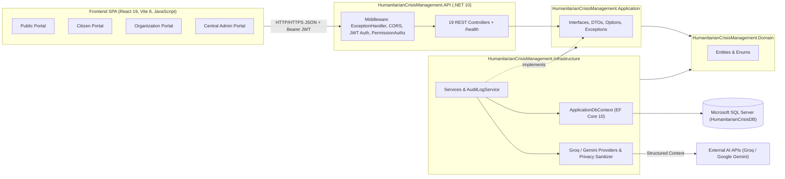
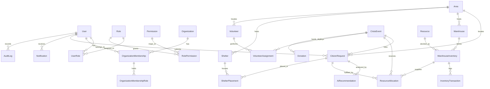

# Humanitarian Crisis Management System (HCMS)

**HCMS (ReliefLink)** is a full-stack humanitarian crisis management and aid coordination platform built with **ASP.NET Core (.NET 10)**, **Entity Framework Core 10**, **Microsoft SQL Server**, and **React 19 + Vite 8 (JavaScript)**.

It addresses the operational fragmentation that occurs during rapid-onset disasters—such as floods, storms, and displacement emergencies—by unifying public crisis reporting, citizen assistance intake, organization coordination, warehouse inventory and resource allocation, shelter capacity management, volunteer deployment, donation tracking, audit logging, and **human-in-the-loop AI decision support**.

**Intended Users:** Affected citizens, public donors and volunteers, humanitarian relief organizations, field responders, crisis managers, and central administrators.

---

## Table of Contents

1. [Project Title and Overview](#1-project-title-and-overview)
2. [Key Features](#2-key-features)
3. [System Architecture](#3-system-architecture)
4. [Technology Stack](#4-technology-stack)
5. [Database Design](#5-database-design)
6. [AI Integration and Decision Support](#6-ai-integration-and-decision-support)
7. [Project Setup and Installation](#7-project-setup-and-installation)
8. [Configuration](#8-configuration)
9. [API Documentation](#9-api-documentation)
10. [Testing](#10-testing)
11. [Repository Structure](#11-repository-structure)
12. [Current Development Status](#12-current-development-status)
13. [Security Considerations](#13-security-considerations)
14. [Contributors](#14-contributors)
15. [License and Academic Context](#15-license-and-academic-context)

---

## 1. Project Title and Overview

- **Full Project Name:** Humanitarian Crisis Management System
- **Abbreviation:** HCMS (UI brand: *ReliefLink*)
- **Repository:** `https://github.com/HKChamod/HumanitarianCrisis.git`

During emergencies, coordinators often rely on disconnected spreadsheets, unverified incident reports, and manual stock checks. HCMS provides a centralized, permission-controlled backend API and four role-oriented frontend portals (**Public**, **Citizen**, **Organization**, and **Central Administration**) to coordinate aid from initial citizen request submission through inventory dispatch, shelter placement, volunteer assignment, and audit tracking.

---

## 2. Key Features

Feature statuses below are verified directly against the current source code:

| Module | Capabilities | Status |
| :--- | :--- | :--- |
| **User Authentication & Account Management** | User registration, JWT Bearer login, `/api/Auth/me`, active/inactive user management, role assignment | **Implemented** |
| **Role-Based Access Control (RBAC) & Permissions** | 35+ policy-based permissions enforced dynamically via `PermissionAuthorizationHandler` against seeded `Roles`, `Permissions`, and `RolePermissions` | **Implemented** |
| **Organization Management & Scoped Memberships** | Organization CRUD, membership applications/approvals, and organization-scoped roles (`OrganizationMembership`, `OrganizationMembershipRole`) | **Implemented** |
| **Crisis Event & Geographical Area Management** | CRUD for `CrisisEvents` (Active, Closed, Resolved) and hierarchical `Areas`, plus interactive Leaflet crisis map | **Implemented** |
| **Assistance Request Management** | Citizen request creation, personal tracking (`GET /api/CitizenRequests/my`), and coordinator status workflow (`Pending → Verified → Assigned → Fulfilled` / `Rejected`) | **Implemented** |
| **Resource & Warehouse Inventory Management** | Resource catalog, warehouses, warehouse inventory levels, reorder thresholds, `StockIn`, `StockOut`, `Adjustment`, and atomic inter-warehouse `Transfer` transactions | **Implemented** |
| **Resource Allocation** | Multi-stage workflow (`Pending → Approved → Dispatched → Delivered` / `Cancelled`) with atomic stock deduction on dispatch and stock restoration on cancelling a dispatched allocation | **Implemented** |
| **Shelter Management** | Shelter CRUD, occupancy tracking, capacity overflow protection, resident placement check-in/check-out, and automatic `Open ↔ Full` status updates | **Implemented** |
| **Volunteer Management** | Public volunteer registration, admin approval workflow, crisis assignments, duplicate-active assignment prevention, and `Available ↔ Deployed` availability transitions | **Implemented** |
| **Donation Management** | Donation recording, verification status tracking, and crisis-linked donation summaries (no live payment gateway) | **Implemented** |
| **AI-Assisted Decision Support** | Configurable Groq & Google Gemini advisory analysis, strict JSON/business-rule validation, privacy sanitization, and human-in-the-loop review (`Approved`, `Overridden`, `Rejected`) | **Implemented** |
| **Reporting, Dashboard, Notifications & Audit Logs** | Operational dashboard summary API, user/role notifications, immutable audit log recording and retrieval, and frontend reporting views | **Implemented** |
| **System Settings Administration UI** | Live mode intentionally displays an informational notice because server configuration is managed via environment variables and User Secrets | **Partially Implemented** |
| **External Payment & SMS/Push Gateways** | Online payment processing and automated SMS/push notifications | **Planned** |
| **Predictive Forecasting & Automated Browser E2E Suite** | Time-series demand forecasting and CI-automated headless browser E2E tests | **Planned** |

---

## 3. System Architecture

### Backend: Clean Architecture (.NET 10)

The backend solution (`HumanitarianCrisisManagement.sln`) is divided into four runtime layers plus a dedicated test project:

1. **Domain Layer (`HumanitarianCrisisManagement.Domain`):** Contains the 22 core domain entities and enums (`AiRecommendationReviewStatus`, `InventoryTransactionType`, `ResourceAllocationStatus`, etc.). Has no external framework or infrastructure dependencies.
2. **Application Layer (`HumanitarianCrisisManagement.Application`):** Defines DTOs with DataAnnotations validation, service and AI provider interfaces (`IAiAnalysisProvider`, `IAiDecisionSupportService`, `IResourceAllocationService`, `IShelterService`, `IVolunteerService`, etc.), `AiProviderOptions`, and application exceptions (`AiProviderUnavailableException`). Depends only on `Domain`.
3. **Infrastructure Layer (`HumanitarianCrisisManagement.Infrastructure`):** Implements all application services, EF Core `ApplicationDbContext`, entity configurations, SQL Server migrations, `JwtTokenService`, `PasswordHasherService`, `AuditLogService`, `AiTextPrivacySanitizer`, `GroqAiAnalysisProvider`, and `GeminiAiAnalysisProvider`. Depends on `Application` and `Domain`.
4. **API Layer (`HumanitarianCrisisManagement.API`):** Hosts the 19 REST controllers, `Program.cs` DI composition, `GlobalExceptionHandler` (`IExceptionHandler`), `PermissionAuthorizationHandler`, CORS, Forwarded Headers, `/health`, and Swagger/OpenAPI. Depends on `Application`, `Domain`, and `Infrastructure`.

This dependency direction isolates business contracts from persistence and external AI HTTP clients, allowing services and full HTTP pipelines to be tested against isolated SQLite in-memory databases and fake AI providers without touching SQL Server or external APIs.

### Frontend: Modular React SPA (JavaScript)

The frontend (`Frontend/`) is a React 19 + Vite 8 Single Page Application written in **JavaScript** (ESM, no TypeScript). It is organized around:
- **Context Providers (`src/app/providers/`, `src/context/`):** `AuthProvider`, `OrganizationProvider`, and `LanguageProvider` (`i18next`).
- **Route Guards (`src/App.jsx`, `src/app/adminRoutes.jsx`):** `ProtectedCitizenRoute`, `ProtectedOrganizationRoute`, and `ProtectedAdminRoute` (with per-route permission checks).
- **Four Portals:** Public Portal (`/`), Citizen Portal (`/citizen/*`), Organization Portal (`/organization/*`), and Central Administration Portal (`/admin/*`, lazy-loaded).
- **Shared API Layer (`src/services/api/apiConfig.js`):** Defaults to live API mode (`VITE_USE_MOCK_API=false`), attaches `Bearer` JWT and `X-Organization-Id` headers, and normalizes API error responses.



---

## 4. Technology Stack

All versions below are verified from `.csproj` and `Frontend/package.json`:

| Category | Technology | Verified Version |
| :--- | :--- | :--- |
| **Backend Framework** | ASP.NET Core Web API (.NET) | `net10.0` (.NET 10) |
| **Programming Languages** | C# (Backend), JavaScript / JSX (Frontend) | C# / ES Modules |
| **ORM & Database** | Entity Framework Core + Microsoft SQL Server | `10.0.14` |
| **Authentication & Authz** | `Microsoft.AspNetCore.Authentication.JwtBearer`, `Microsoft.Extensions.Identity.Core` | `10.0.14` |
| **API Documentation** | `Swashbuckle.AspNetCore` (Swagger / OpenAPI) | `6.6.2` |
| **AI Providers & Models** | Groq (`openai/gpt-oss-120b`), Google Gemini (`gemini-3.1-flash-lite`) | Configured via `AiProvider` options |
| **Frontend Framework & Build** | React, React DOM, Vite, Tailwind CSS (`@tailwindcss/vite`) | React `19.3.1`, Vite `8.3.5`, Tailwind `4.3.5` |
| **Frontend Libraries** | React Router DOM `7.18.5`, Axios `1.21.1`, React Hook Form `7.92.0`, Zod `4.6.7`, TanStack Table `9.3.1`, Leaflet `1.9.4`, Recharts `3.11.0`, i18next `27.1.5`, Lucide React `1.75.0` | See `Frontend/package.json` |
| **Frontend Linting** | `oxlint` | `1.89.0` |
| **Backend Testing** | xUnit `2.9.3`, `Microsoft.NET.Test.Sdk` `17.13.0`, `xunit.runner.visualstudio` `2.8.2`, `Microsoft.EntityFrameworkCore.Sqlite` `10.0.14`, `Microsoft.AspNetCore.Mvc.Testing` `10.0.14` | No third-party mocking library (uses custom fakes/stubs) |

---

## 5. Database Design

`ApplicationDbContext` defines **22 DbSets** backed by **17 EF Core migrations** in `Infrastructure/Data/Migrations/` (latest migration: `20261126130601_AddOrganizationOperationsAndSettings`).

### Entity Implementation & Migration Status

| Entity Group | Entities | In Source Code | In EF Core Migrations |
| :--- | :--- | :---: | :---: |
| **Identity & RBAC** | `User`, `Role`, `UserRole`, `Permission`, `RolePermission` | Yes | Yes |
| **Organizations** | `Organization`, `OrganizationMembership`, `OrganizationMembershipRole` | Yes | Yes |
| **Crises & Intake** | `Area`, `CrisisEvent`, `CitizenRequest` | Yes | Yes |
| **Inventory & Allocations** | `Resource`, `Warehouse`, `WarehouseInventory`, `InventoryTransaction`, `ResourceAllocation` | Yes | Yes |
| **AI Decision Support** | `AiRecommendation` | Yes | Yes |
| **Operational Modules** | `Shelter`, `ShelterPlacement`, `Volunteer`, `VolunteerAssignment`, `Donation`, `Notification`, `AuditLog` | Yes | Yes |

### Simplified Entity Relationship Diagram



---

## 6. AI Integration and Decision Support

### Integrated Providers & Selection
- **Providers:** `GroqAiAnalysisProvider` (`https://api.groq.com/openai/v1/chat/completions`, default model `openai/gpt-oss-120b` with `include_reasoning: false`, `reasoning_effort: "low"`) and `GeminiAiAnalysisProvider` (default model `gemini-3.1-flash-lite`).
- **Selection & Fallback:** `DependencyInjection.AddAiAnalysisProviderSelection()` resolves Groq if configured, then Gemini if configured, and otherwise falls back to `UnconfiguredAiAnalysisProvider` (which safely reports unconfigured status and throws `AiProviderUnavailableException` → HTTP `503` without crashing the API).

### Workflow, Safeguards & Error Handling
1. **Advisory Capabilities:** Request category suggestion, urgency assessment, potential duplicate request detection, available warehouse inventory suggestion, confidence score (`0..1`), and human-readable explanation.
2. **Privacy Minimization:** `AiProvider:IncludeSanitizedDescriptions` defaults to `false`. When enabled, `AiTextPrivacySanitizer` redacts phone numbers, emails, and NIC patterns before sending context externally.
3. **Validation:** `AiDecisionSupportService` strictly validates returned JSON fields, allowed categories/urgencies, confidence range, known duplicate request IDs, valid inventory IDs, and non-exceeding stock quantities.
4. **Retries & Fault Isolation:** Transient HTTP `503` responses are retried with bounded exponential backoff + jitter (max 2 retries); `400`/`401`/`403`/`404` are not retried; `429` quota errors are handled distinctly. AI outages never block `POST /api/CitizenRequests` or manual resource allocations.
5. **Human-in-the-Loop Governance:** Recommendations are saved in `PendingReview` state and require an authorized reviewer (`AI.Review`) to submit `Approved`, `Overridden`, or `Rejected` via `PATCH /api/AiRecommendations/{id}/review`. Duplicate reviews are rejected (`400 Bad Request`). AI never directly modifies `CitizenRequest`, `ResourceAllocation`, or `WarehouseInventory`.

### Known Limitations & Testing Distinction
- Automated CI/local backend tests use deterministic fake/stub `IAiAnalysisProvider` implementations and synthetic data.
- Live Groq verification (`LiveGroqSyntheticValidationTests.cs`) is **opt-in** and evaluates fictional synthetic crisis scenarios rather than real-world labeled humanitarian datasets. Statistical accuracy benchmarks on real citizen data have not been performed.

---

## 7. Project Setup and Installation

### Prerequisites
- **.NET 10 SDK** (`net10.0`)
- **Node.js (v20+ recommended)** and **npm**
- **Microsoft SQL Server** (e.g., SQL Server Express `.\SQLEXPRESS` or LocalDB)
- **EF Core CLI** (optional, for running migrations manually):
  ```powershell
  dotnet tool install --global dotnet-ef
  ```

### Step-by-Step Setup (Windows PowerShell)

1. **Clone the repository:**
   ```powershell
   git clone https://github.com/HKChamod/HumanitarianCrisis.git
   cd HumanitarianCrisis
   ```

2. **Configure User Secrets (recommended for local JWT & AI keys):**
   ```powershell
   $apiProject = "Backend/HumanitarianCrisisManagement/HumanitarianCrisisManagement/HumanitarianCrisisManagement.API"
   dotnet user-secrets set "ConnectionStrings:DefaultConnection" "Server=.\SQLEXPRESS;Database=HumanitarianCrisisDB;Trusted_Connection=True;TrustServerCertificate=True;" --project $apiProject
   dotnet user-secrets set "Jwt:Key" "<YOUR-BASE64-32-BYTE-SECRET-KEY>" --project $apiProject
   # Optional AI provider configuration (Groq or Gemini):
   dotnet user-secrets set "AiProvider:Provider" "Groq" --project $apiProject
   dotnet user-secrets set "AiProvider:GroqApiKey" "<YOUR-GROQ-API-KEY>" --project $apiProject
   ```

3. **Restore NuGet packages and build the backend:**
   ```powershell
   dotnet restore Backend/HumanitarianCrisisManagement/HumanitarianCrisisManagement/HumanitarianCrisisManagement.sln
   dotnet build Backend/HumanitarianCrisisManagement/HumanitarianCrisisManagement/HumanitarianCrisisManagement.sln -c Release
   ```

4. **Apply EF Core migrations to SQL Server:**
   ```powershell
   cd Backend/HumanitarianCrisisManagement/HumanitarianCrisisManagement
   dotnet ef database update --project HumanitarianCrisisManagement.Infrastructure --startup-project HumanitarianCrisisManagement.API
   ```
   *(In `Development` mode, `Program.cs` also invokes `db.Database.Migrate()` on startup.)*

5. **Run the backend API:**
   ```powershell
   dotnet run --project HumanitarianCrisisManagement.API
   ```
   Default local URLs (from `launchSettings.json`): `http://localhost:5107` and `https://localhost:7104`.

6. **Install and run the React frontend (from repository root in a second terminal):**
   ```powershell
   cd Frontend
   Copy-Item .env.example .env
   npm install
   npm run dev
   ```
   Default Vite dev server URL: `http://localhost:5173`.

---

## 8. Configuration

### Backend (`appsettings.json`, User Secrets, Environment Variables)

Store sensitive keys (`Jwt:Key`, `AiProvider:GroqApiKey`, `AiProvider:GeminiApiKey`, and production SQL credentials) in **.NET User Secrets** (`UserSecretsId` configured in `HumanitarianCrisisManagement.API.csproj`) for local development or **environment variables** in staging/production.

```json
{
  "ConnectionStrings": {
    "DefaultConnection": "Server=YOUR_SQL_SERVER;Database=HumanitarianCrisisDB;Trusted_Connection=True;TrustServerCertificate=True;"
  },
  "Jwt": {
    "Key": "<BASE64_ENCODED_MIN_32_BYTE_KEY>",
    "Issuer": "HumanitarianCrisisManagementAPI",
    "Audience": "HumanitarianCrisisManagementClient",
    "AccessTokenExpirationMinutes": 60
  },
  "AiProvider": {
    "Provider": "None",
    "Model": "gemini-3.1-flash-lite",
    "GroqModel": "openai/gpt-oss-120b",
    "GroqBaseUrl": "https://api.groq.com/openai/v1",
    "TimeoutSeconds": 120,
    "IncludeSanitizedDescriptions": false
  },
  "Cors": {
    "AllowedOrigins": [ "http://localhost:5173" ]
  }
}
```

### Frontend (`Frontend/.env`)

```env
VITE_API_BASE_URL=http://localhost:5107/api
VITE_USE_MOCK_API=false
VITE_MAPTILER_KEY=YOUR_MAPTILER_API_KEY_HERE
```

---

## 9. API Documentation

- **Local API Base URL:** `http://localhost:5107/api` (or `https://localhost:7104/api`)
- **Health Check:** `GET http://localhost:5107/health`
- **Swagger UI (Development environment):** `http://localhost:5107/swagger` / `https://localhost:7104/swagger`
- **API Versioning:** Not used; routes follow `[Route("api/[controller]")]`.
- **Authentication:** Click **Authorize** in Swagger and supply `Bearer <access_token>` obtained from `POST /api/Auth/login`.

### Verified Controller Route Groups
- **Auth & Identity:** `/api/Auth` (`register`, `login`, `me`), `/api/Users`, `/api/Roles`
- **Organizations:** `/api/Organizations`
- **Crises, Areas & Requests:** `/api/CrisisEvents`, `/api/Areas`, `/api/CitizenRequests` (`my`, `{id}/status`)
- **Logistics:** `/api/Resources`, `/api/Warehouses`, `/api/WarehouseInventories`, `/api/InventoryTransactions` (`transfer`), `/api/ResourceAllocations` (`my`, `{id}/approve`, `{id}/reject`, `{id}/dispatch`, `{id}/deliver`, `{id}/cancel`)
- **Operations:** `/api/Shelters` (`placements`, `placements/{placementId}/checkout`), `/api/Volunteers` (`{id}/approval`, `assignments`, `assignments/{assignmentId}/status`), `/api/Donations`
- **AI Decision Support:** `/api/AiRecommendations` (`status`, `diagnostic`, `analyze/{citizenRequestId}`, `{id}/review`)
- **Monitoring:** `/api/Dashboard`, `/api/Notifications`, `/api/AuditLogs`

---

## 10. Testing

### Backend Test Project (`HumanitarianCrisisManagement.Tests`)
- **Frameworks:** xUnit (`2.9.3`), `Microsoft.NET.Test.Sdk` (`17.13.0`), `Microsoft.EntityFrameworkCore.Sqlite` (`10.0.14`), `Microsoft.AspNetCore.Mvc.Testing` (`10.0.14`). Custom fakes/stubs are used instead of third-party mocking libraries.
- **Test Categories:**
  - **Unit & Provider Tests:** `AiTextPrivacySanitizerTests.cs`, `GeminiAiAnalysisProviderTests.cs`, `GroqAiAnalysisProviderTests.cs`, `OperationalModuleValidationTests.cs`
  - **Persistence Integration Tests (SQLite in-memory):** `AiRecommendationReviewPersistenceTests.cs`
  - **API E2E Integration Tests (`WebApplicationFactory` + SQLite in-memory):** `AiRecommendationApiIntegrationTests.cs`, `OperationalWorkflowIntegrationTests.cs`, `EndToEndHumanitarianWorkflowTests.cs`
  - **Concurrency, Citizen Data Isolation & Organization Scoping Tests:** `ConcurrencyAndSecurityIsolationTests.cs` (isolated file-backed SQLite contention tests + opt-in SQL Server staging guard)
  - **Opt-In Live AI Synthetic Harness:** `LiveGroqSyntheticValidationTests.cs` + `SyntheticGroqScenarios.cs` (opt-in; requires configured Groq key)

### Frontend Tests & Quality Scripts (`Frontend/`)
- `Frontend/src/testIntegration.mjs` — local mapper/RBAC checks and optional live HTTP checks
- `Frontend/src/testE2eAuthenticated.mjs` — opt-in authenticated non-destructive HTTP E2E script against a running API

### Execution Commands

```powershell
# Run all deterministic backend tests
dotnet test Backend/HumanitarianCrisisManagement/HumanitarianCrisisManagement/HumanitarianCrisisManagement.Tests/HumanitarianCrisisManagement.Tests.csproj -c Release

# Run frontend local integration checks, lint, and production build
npm --prefix Frontend run test
npm --prefix Frontend run lint
npm --prefix Frontend run build
```

---

## 11. Repository Structure

```text
HumanitarianCrisis/
├── Backend/
│   └── HumanitarianCrisisManagement/
│       └── HumanitarianCrisisManagement/
│           ├── HumanitarianCrisisManagement.API/            # 19 Controllers, Authorization, GlobalExceptionHandler, Program.cs
│           ├── HumanitarianCrisisManagement.Application/    # DTOs, Service & AI Interfaces, Options, Exceptions
│           ├── HumanitarianCrisisManagement.Domain/         # 22 Entities, Domain Enums
│           ├── HumanitarianCrisisManagement.Infrastructure/ # ApplicationDbContext, 17 Migrations, Services, AI Providers
│           ├── HumanitarianCrisisManagement.Tests/          # xUnit Unit, Persistence, API & Workflow Integration Tests
│           └── HumanitarianCrisisManagement.sln
├── Frontend/
│   ├── src/
│   │   ├── api/                                             # Public API helpers & optional mock data
│   │   ├── app/                                             # adminRoutes.jsx, AuthProvider, OrganizationProvider
│   │   ├── components/                                      # Shared layouts & UI components
│   │   ├── context/                                         # LanguageContext (i18next)
│   │   ├── features/                                        # Public, Citizen & Central Admin feature modules
│   │   ├── organization/                                    # Organization Portal views
│   │   ├── services/api/                                    # Shared Axios/Fetch live API configuration
│   │   ├── App.jsx
│   │   ├── testIntegration.mjs
│   │   └── testE2eAuthenticated.mjs
│   ├── .env.example
│   └── package.json
└── README.md
```

---

## 12. Current Development Status

- **Completed:** Core `.NET 10` Clean Architecture backend (19 controllers, 22 entities, 17 EF Core migrations), JWT + permission-based RBAC, Groq & Gemini AI decision-support providers with human-in-the-loop review and privacy guardrails, transactional warehouse/inventory/allocation/shelter/volunteer workflows, audit logging, four live-wired React 19 portals, and automated unit/persistence/API/workflow integration tests.
- **Partially Completed:** Frontend `oxlint` passes with 0 errors while non-blocking unused-import/fast-refresh warnings remain; System Settings UI is intentionally read-only/informational in live mode; automated integration tests run against SQLite in-memory rather than a dedicated CI SQL Server instance.
- **Planned / Not Implemented:** Live payment gateway integration, automated SMS/push notification providers, predictive demand forecasting, and CI-automated browser E2E testing.

The system is currently prepared for **local demonstration and academic evaluation**.

---

## 13. Security Considerations

- **Authentication & Passwords:** Stateless HS256 JWT Bearer authentication (`JwtTokenService`) enforcing a minimum 32-byte signing key, paired with salted password hashing (`PasswordHasherService`).
- **Authorization:** Granular permission policies enforced server-side by `PermissionAuthorizationHandler` on every protected endpoint; unauthenticated requests return `401` and unauthorized actions return `403`.
- **AI Data Minimization:** `IncludeSanitizedDescriptions=false` by default prevents raw citizen free-text from being sent to external LLM providers.
- **Secrets Hygiene Notice:** `appsettings.json` and `appsettings.Development.json` contain a local development JWT key placeholder for out-of-the-box local testing. **Never reuse that key outside local development**—override `Jwt:Key`, database credentials, and AI API keys using .NET User Secrets or secure environment variables in any shared or deployed environment.

---

## 14. Contributors

The following six contributors are verified from the repository Git commit history (`git shortlog -sn --no-merges HEAD`):

- Hiran Chamod
- HasiruW
- sineth07
- Thisuni Weerathunga
- wnkpiyarathna
- D N Thakshini

---

## 15. License and Academic Context

No open-source license file (`LICENSE`) has currently been specified in this repository.

This project was developed as an academic Software Architecture project demonstrating Clean Architecture, role-based access control, transactional operational workflows, and human-in-the-loop AI decision support for humanitarian crisis response.
